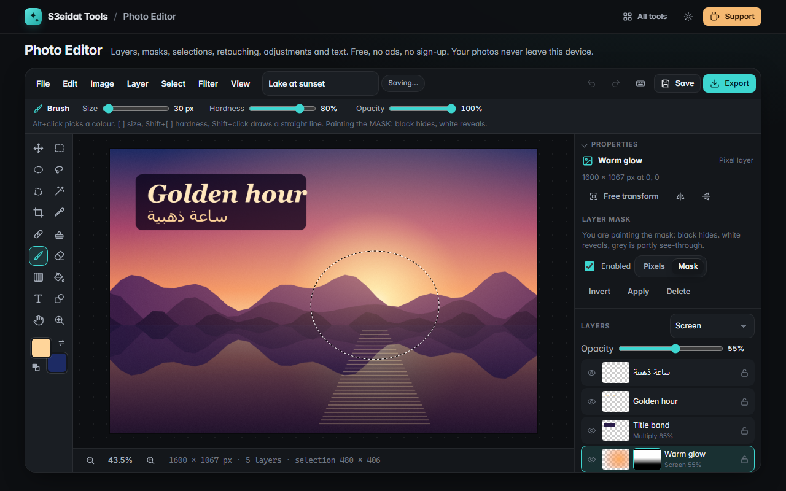

# Photo Editor

> A layered photo editor in your browser: layers and masks, selections, retouching, adjustments, text and export. Free, private, no ads, no sign-up, and it runs entirely on your device.

### ▶ [Open Photo Editor](https://s3eidat.github.io/photo-editor/)



A free, local-first alternative to image editors like Photoshop, for the everyday core: open a photo, fix it, add text, export.

## Features

- **Documents** from any image (PNG, JPG, WebP, GIF, BMP, AVIF; drop, paste or pick, several at once) or blank with **12 size presets** (social, HD/4K, A4/Letter at 300 dpi, photo prints) and a white, transparent or coloured background
- **Layers**: pixel, **live text** and **live shape** layers; add, duplicate, delete, drag to reorder, rename, hide, lock, opacity and **blend modes** (normal, multiply, screen, overlay, darken, lighten, difference); merge down, merge visible, flatten, layer via copy / cut
- **Layer masks**: add (reveal all or from the selection), paint black to hide and white to reveal with any brush, gradient or fill, enable/disable, invert, apply, delete
- **Selections**: rectangle, ellipse, lasso, polygonal lasso and **magic wand** (tolerance, contiguous, all layers), with new / add / subtract / intersect (or Shift / Alt / Shift+Alt), select all, deselect, inverse, **feather**, expand, contract, select layer pixels. Painting, fills, adjustments and filters stay inside the selection
- **Move and free transform**: move a layer or the selected pixels (Alt to copy), scale, rotate and flip with handles or numbers; text and shapes stay editable after transforming
- **Crop** with ratios (1:1, 4:5, 3:2, 4:3, 16:9, 9:16, original) and rule-of-thirds guides, **canvas size** with anchor, **image size**, rotate 90°/180°, flip canvas
- **Brush and eraser** with size, hardness and opacity (one opacity per stroke, like the pros), straight lines with Shift; **gradient** (linear/radial, to transparent) and **paint bucket**; **eyedropper**
- **Clone stamp** and **healing brush** (copies texture from the source and matches the colour and brightness around the stroke)
- **Text** with any font installed on your device, bold, italic, alignment, line height, rotation and **Arabic / right-to-left** (auto-detected or forced)
- **Shapes**: rectangle (rounded corners), ellipse, triangle, star, arrow and line with fill and stroke
- **Adjustments** with live preview: brightness/contrast, **levels** (with auto), **curves** (RGB and per channel), exposure, **hue/saturation** (and colorize), vibrance, colour balance, black & white, invert, desaturate, threshold
- **Filters**: Gaussian blur, sharpen, **unsharp mask**, add noise, pixelate, vignette
- **History panel** with undo/redo and jump to any step. Steps store only the changed 64 px tiles and stay within a memory budget
- Zoom and pan (wheel, Space-drag, pinch), **keyboard shortcuts** close to industry conventions (press `?`)
- **Autosave** in this browser (IndexedDB) with a recent-projects list; **save and open `.s3photo` project files** (layers, masks, text and shapes stay editable). Opened files are checked field by field before use
- **Export as** PNG, JPG, WebP, AVIF, **TIFF**, BMP, **PNG-8** and **GIF** with quality, size (or pixel-art scaling), transparency or a matte, a live preview with the real file size, and optional author / copyright metadata; **quick export**, **export layers to files** (one .zip), export just the selection, and **print** with crop and registration marks
- **PSD files**: open and save layered PSDs (layers, masks, vector masks, groups, live text and shapes, blend modes, opacity, layer styles, adjustment and fill layers, guides, notes); **TIFF** open and save
- **Workspace**: documents in **tabs**, **rulers**, **guides** (and guide layouts), **grid**, **snapping** and **smart guides**, **navigator**, **histogram**, **info** panel (RGB / HSB / Lab), dockable and floating panels with **saved workspaces**, **customizable shortcuts**, **preferences**
- **Automation and output**: **actions** (record, play, edit, import / export) and **batch** processing to a .zip, **image modes** (greyscale, duotone, indexed colour with palette export), **proof colours** (simulated CMYK, colour-blindness) with a gamut warning, **ruler**, **note** and **count** tools, **trim** and **reveal all**

## Limits

- Documents are limited to 8000 px a side and 40 megapixels (bigger images are scaled down when opened, with a message).
- 8-bit RGB editing: 16/32-bit PSD and TIFF files are converted on open; CMYK and Lab PSDs and PSB files cannot be opened. Colour proofing is simulated (no ICC profiles).
- No AI features (generative fill, sky replacement, background removal), no adjustment layers or layer styles yet.
- Fonts are the ones on your device; a project file opened on another device falls back if the font is missing.
- Free transform on a pixel layer is applied when you press Apply (pixels are resampled once).
- Some browsers reserve Ctrl+T, Ctrl+N and Ctrl+Shift+N; use the menu, the buttons, or the alternatives in the shortcut list.

## Privacy

Your photos never leave your device. There is no server, no account and no analytics.
The page ships with a strict Content-Security-Policy (`connect-src 'self'`), so the browser itself blocks
any attempt to send data anywhere. Projects are stored only in this browser until you save a file.

## Run it yourself

It's plain HTML, CSS and JavaScript with no build step; the only library is [ag-psd](https://github.com/Agamnentzar/ag-psd) (MIT, vendored in `lib/`) for PSD files:

```bash
git clone https://github.com/s3eidat/photo-editor
cd photo-editor
python -m http.server 8000
```

Then open http://localhost:8000. Heavy pixel work runs in a Web Worker (`js/worker.js`).

## Support

If this saved you time, **[buy me a coffee ☕](https://s3eidat.github.io/coffee/)**. It keeps every tool free.

---

Part of **[S3eidat Tools](https://s3eidat.github.io/)**: 100+ free, private tools that run in your browser. MIT licensed.
